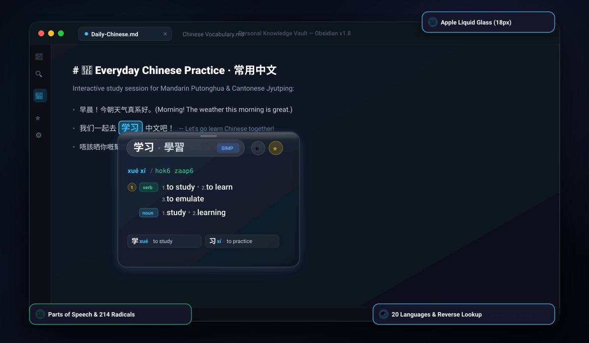

# 🏮 Chinese Popover Dictionary for Obsidian

<p align="center">
  
</p>

<p align="center">
  <a href="https://obsidian.md"></a>
  <a href="https://github.com/Kantulaev/obsidian-chinese-popover/releases"></a>
  <a href="LICENSE"></a>
  
  
  
  
  
</p>

<p align="center">
  <b>Instant, beautiful Chinese popover lookup and personal vocabulary book for Obsidian.</b><br/>
  Featuring dual <b>Mandarin Pinyin</b> and <b>Cantonese Jyutping</b>, smart Chinese word selection (word splitting), authentic neural audio pronunciation, simplified & traditional Hanzi, and an Apple Liquid Glass aesthetic.
</p>

---

## 🌟 Why Chinese Popover Dictionary?

Reading and studying Chinese in Obsidian shouldn't pull you out of your flow. **Chinese Popover Dictionary** brings a desktop-grade popover experience directly into your notes:

* 📌 **Pin (Sticky) Mode** — Freeze the popover on your screen while typing notes or scrolling. Won't dismiss until you press <kbd>Esc</kbd> or click ✕.
* ✋ **Draggable Popovers** — Grab the top header bar and smoothly drag the popover anywhere on screen to uncover surrounding text.
* ↔️ **Resizable Popovers** — On-the-fly mouse resizing by pulling the bottom-right corner to match your monitor and text preferences.
* 🕒 **Recent Lookups History** — Automatically captures your recent lookups in a dedicated sidebar tab with relative timestamps, quick audio, and 1-click ⭐ vocabulary save.
* 🔍 **Spotlight Dictionary Quick Search** — Command-palette modal (`Alt + S`) to search 118,000+ words by Hanzi (`你好`), Pinyin (`nihao`), Jyutping, or Russian/English translations.
* ⌨️ **One-Key Popover Actions** — Instant keyboard actions when viewing words: <kbd>Space</kbd>/<kbd>R</kbd> (Audio), <kbd>S</kbd> (Star), <kbd>N</kbd> (Note), <kbd>C</kbd> (Copy), <kbd>P</kbd> (Pin), <kbd>Esc</kbd> (Close).
* 📋 **Smart Copy Formats** — Copy complete card (`你好 [nǐ hǎo] hello`), Hanzi only, Pinyin only, Obsidian Wikilink (`[[你好]]`), or Markdown table row via click or right-click menu.
* 💎 **Apple Liquid Glass Design** — Translucent frosted glass squircle with fluid blur effects, crisp typography, and adaptive light/dark theming.
* 🇷🇺 **Russian & English Translations** — Choose English (CC-CEDICT default), Russian (БКРС / Большой китайско-русский словарь), or both simultaneously!
* 🏷️ **Parts of Speech (POS / 词类)** — Identifies parts of speech (verb, noun, adj, adv, classifier, pronoun), including multi-POS behavior (兼类词, e.g. `学习` as noun & verb).
* 🌈 **Pleco-Style Tone Colors** — Visual tone coding for Pinyin and Jyutping (1st Red, 2nd Green, 3rd Blue, 4th Purple, Neutral Gray).
* 📊 **Text Difficulty & HSK Level Analyzer** — Evaluates entire notes or selections, showing HSK 1–6 percentage distribution, CEFR estimates, and vocabulary breakdown.
* 📝 **Zettelkasten Atomic Word Notes** — 1-click generation of structured Markdown notes in `Chinese/Words/` with YAML metadata, tags, readings, and context sentences.
* 📜 **Chengyu Origin Stories (成语故事)** — Expandable ancient fables, allegorical meanings, and historical dynasty context for 4-character idioms.
* 💬 **Authentic Example Sentences (例句)** — Contextual example sentences with pinyin, translations, and click-to-pronounce audio.
* 🖨️ **Printable Calligraphy Worksheets (米字格 Mizige)** — Generate and print practice sheets with stroke tracing and blank grids directly to paper or PDF.
* 📱 **Pleco Mobile Flashcards Export** — Export vocabulary directly to Pleco `.txt` format for import into Pleco on iOS and Android.
* 🔄 **Simplified ↔ Traditional Converter** — 1-click bidirectional conversion of selected text between 简体 and 繁體.
* 🗣️ **Paragraph & Selection TTS** — Listen to whole sentences or paragraphs in Cantonese or Mandarin.
* ✂️ **Smart Chinese Word Selection (Word Splitting)** — Double-clicking any Chinese character cleanly selects the exact word (`学习` or `香港`) instead of a single character or the entire paragraph, powered by CEDICT and native `Intl.Segmenter`.
* 🎯 **HSK 1–6 Exam Level Badges** — Instant visual badges for official HSK levels on cards and popovers, plus due review filters.
* 🖋️ **Official HSK Exam Typography** — Select the standard official HSK exam font **KaiTi (楷体)**, SongTi, HeiTi, FangSong, or LXGW WenKai for your dictionary and editor.
* 🖌️ **Animated Stroke Order (米字格)** — Step-by-step vector calligraphy animation modal with character tabs and playback controls.
* 🗃️ **1-Click Anki Integration** — Push cards directly into Anki via AnkiConnect or export offline `.tsv` decks.
* 🔁 **Spaced Repetition (SRS) Flashcards** — Built-in SM-2 intervals (Again 1d, Hard, Good, Easy) stored permanently in your vault.
* 🔬 **Kangxi Radicals & Character Breakdown** — Kangxi 214 radicals, stroke counts, and ideogram component breakdowns.
* 🏮 **Reader Mode** — Instant hover lookup without modifier keys for effortless reading, toggled via status bar or hotkey.
* 🔤 **Ruby / Furigana Generator** — Generate `<ruby>汉<rt>hàn</rt></ruby>` or Jyutping markup over selected text in 1 click.
* 📖 **Permanent Personal Vocabulary Notebook** — Star difficult words with `⭐` in 1 click; they are saved permanently into a clean Markdown note in your vault (`Chinese Vocabulary.md`).
* 🃏 **Interactive Sidebar & Flashcards** — Review saved words in a sleek right sidebar tab with search, filters, audio buttons, and tap-to-reveal quiz mode.
* 🀄 **Dual Phonetics (Pinyin + Jyutping)** — Perfect for learners of both Mandarin (`Putonghua`) and Cantonese (`Guangdonghua`).
* 🔊 **Native Voice Pronunciation** — Studio-quality neural audio for both dialects with adjustable playback speed (0.5x – 1.4x) and offline Web Speech support.
* ⚡ **Instant Multi-Trigger Access** — Double-click, hover with modifier key (`Option / Alt / Shift / Cmd / Ctrl`), or hotkey navigation.
* 📚 **Massive Vocabulary (118,000+ words)** — Powered by CC-CEDICT merged with Pleco's Cantonese readings, CC-Canto, and Rime Cantonese.
* 🛡️ **Obsidian Margin Protection** — Automatically stays within your text container and never spills off-screen or into empty side margins.

---

## 📸 Overview

```text
┌────────────────────────────────────────────────────────────────┐
│  你好  [HSK 1]  |  你好   🔊 廣東話 0.8x  🖌️ 📋 ⭐ Star  ✕   │
├────────────────────────────────────────────────────────────────┤
│  nǐ hǎo         粵 nei5 hou2                                   │
├────────────────────────────────────────────────────────────────┤
│  • hello  • hi  • how are you                                  │
├────────────────────────────────────────────────────────────────┤
│  [ 你 nǐ · you ]  [ 好 hǎo · good, well ]                      │
└────────────────────────────────────────────────────────────────┘
```

---

## ✨ Feature Highlights

### 1. Dual Phonetic Support
Display tone-marked Pinyin alongside Cantonese Jyutping simultaneously, or switch modes on the fly:
* **Both (`both`)**: Displays Mandarin Pinyin with diacritics (`nǐ hǎo`) and a dedicated green Jyutping badge (`粵 nei5 hou2`).
* **Pinyin only (`pinyin`)**: Focused view for Mandarin learners.
* **Jyutping only (`jyutping`)**: Tailored for Cantonese learners.
* **Auto by Dialect (`dialect_auto`)**: Automatically highlights the phonetics corresponding to your selected speech dialect.

### 2. Authentic Neural Pronunciation
* **Cantonese (`廣東話`)**: Natural Hong Kong neural voice (`zh-HK` / `yue`).
* **Mandarin (`普通话`)**: Clear Putonghua neural voice (`zh-CN`).
* **Adjustable Speed**: Slow down pronunciation (default `0.8x`) to hear tones with razor-sharp clarity.
* **Smart Fallback**: Online Google HD TTS with automatic fallback to local Web Speech API.

### 3. Simplified & Traditional Hanzi
* Displays both Simplified and Traditional characters side-by-side in equal font size.
* Configurable separator (` - `, ` / `, ` · `, or `( )`).
* Option to hide Traditional characters for a more compact card.

### 4. Smart Positioning & Margin Clamping
* Designed specifically for Obsidian's **"Readable line length"** mode.
* Clamps popovers inside the active note container to avoid hanging awkwardly into empty grey side margins.
* Auto-flips vertically if a word is near the top edge of your screen.

### 5. 📖 Personal Vocabulary Notebook & Spaced Repetition (SRS)
* **Permanent Vault Storage**: Star difficult words with `⭐` in the popover or via hotkey. All saved words are stored permanently in a clean Markdown note in your vault (`Chinese Vocabulary.md`).
* **Right Sidebar Tab**: Access your vocabulary anytime with the ribbon icon (`book-marked`) or command palette.
* **Interactive Liquid Glass Cards**: Each card shows Simplified/Traditional Hanzi, tone-marked Pinyin, green Jyutping badge, definitions, context sentence, and an instant audio playback button.
* **🔁 Spaced Repetition (SRS Flashcards)**: Grade your recall with **Again (1d)**, **Hard**, **Good**, or **Easy**. Interval reviews are saved to both plugin data and your Markdown note.
* **Filter Due Reviews**: Click the `🔁 К повторению` button in the sidebar to review only words scheduled for today.

### 6. 🎯 Official HSK Exam Level Badges (HSK 1 to 6)
* Color-coded badges indicating official Hànyǔ Shuǐpíng Kǎoshì proficiency levels (HSK 1 through HSK 6).
* Visible on popovers, sidebar vocabulary cards, and review modes.

### 7. 🖋️ Official HSK Exam Font & Typography
* **HSK Exam Font (KaiTi / 楷体)**: Standard official font used on Chinese HSK exam papers and textbooks.
* **Additional Font Presets**:
  * SongTi (宋体 / SimSun) — Classic print serif
  * HeiTi (黑体 / PingFang / YaHei) — Modern clean sans-serif
  * FangSong (仿宋) — Official and academic document style
  * LXGW WenKai (霞鹜文楷) — Elegant open-source screen calligraphy font
  * Custom font — Enter any system font name
* **Scope**: Apply to Popover & Sidebar only, or to the entire Obsidian editor!

### 8. 🖌️ Stroke Order Animation (米字格 Mizige)
* Click the brush icon `🖌️` or use the command palette to open the stroke order modal.
* Features pure vector animations, Mizige calligraphic guidelines, step-by-step navigation, and multi-character tabs.

### 9. 🗃️ Anki Integration (AnkiConnect & TSV Export)
* **1-Click Sync to Anki**: Directly export cards to your desktop Anki via AnkiConnect API (port 8765).
* **Auto-Sync on Star**: Automatically create an Anki note whenever you star a word!
* **Offline TSV Export**: Download your entire vocabulary as a `.tsv` file ready for manual import on any device.

### 10. 🔬 Character Breakdown (Разбор по иероглифам)
* Compound words ($\ge 2$ characters) feature a breakdown row in the popover.
* Click any character chip to listen to its pronunciation individually.

### 11. 🏮 Reader Mode & 🔤 Ruby Furigana
* **Reader Mode**: Hover over Chinese words to inspect them instantly without holding down modifier keys. Toggle on/off via the status bar pill (`🏮 Чтение: ВКЛ/ВЫКЛ`) or command palette.
* **Ruby / Furigana Generator**: Select Chinese text in the editor and run `Добавить пиньинь (Ruby)` to convert it to `<ruby>中<rt>zhōng</rt>文<rt>wén</rt></ruby>`.

### 12. ✂️ Native Word Selection & Cantonese Phrase Intelligence
* **Obsidian-Native Word Selection**: Standard Chinese words, 4-character idioms (成语 chengyu like `一心一意`), and compounds are selected directly via Obsidian's built-in editor selector without unwanted shrinking or overriding.
* **🇭🇰 Dedicated Cantonese Phrase Selection (Toggleable)**: Accurately detects and highlights full Cantonese phrases (`唔該晒`, `點解`, `睇唔明`, `去唔去`, `食緊`, `𠵱家`, etc.).

---

## 🚀 Quick Start

### Installation via Community Directory (Recommended)
1. In Obsidian, go to **Settings** > **Community plugins**.
2. Make sure **Restricted mode** is turned **off**.
3. Click **Browse** and search for `Chinese Popover Dictionary`.
4. Click **Install**, then click **Enable**.

### Manual Installation
1. Download `main.js`, `manifest.json`, and `styles.css` from the latest [GitHub Release](https://github.com/Kantulaev/obsidian-chinese-popover/releases).
2. Create a folder named `chinese-popover-dict` in your vault's plugins folder:
   ```text
   <YourVault>/.obsidian/plugins/chinese-popover-dict/
   ```
3. Place `main.js`, `manifest.json`, and `styles.css` into that folder.
4. Reload Obsidian and enable the plugin under **Settings** > **Community plugins**.

---

## ⌨️ Hotkeys & Commands

All actions can be bound to your favorite keyboard shortcuts under **Settings** > **Hotkeys**:

| Command | Suggested Shortcut | Description |
| :--- | :---: | :--- |
| **Look up word under cursor or selection** | <kbd>Alt</kbd> + <kbd>D</kbd> | Opens popover for active cursor position or selection |
| **Star or unstar word** | <kbd>Alt</kbd> + <kbd>B</kbd> | Adds or removes word from Personal Vocabulary notebook |
| **Create Zettelkasten Word Note** | <kbd>Alt</kbd> + <kbd>N</kbd> | Generates an atomic Markdown note with YAML in `Chinese/Words/` |
| **Analyze Text Difficulty & HSK** | <kbd>Alt</kbd> + <kbd>A</kbd> | Analyzes HSK level distribution and CEFR difficulty |
| **Open Calligraphy Worksheets** | — | Opens printable Tianzige / Mizige practice sheets modal |
| **Export Pleco Flashcards** | — | Exports vocabulary as a `.txt` deck for Pleco mobile app |
| **Speak Selected Text** | <kbd>Alt</kbd> + <kbd>R</kbd> | Reads aloud selected sentences/paragraphs with neural TTS |
| **Convert to Traditional (繁體)** | — | Bidirectional conversion of selected text to traditional Hanzi |
| **Convert to Simplified (简体)** | — | Bidirectional conversion of selected text to simplified Hanzi |
| **Open vocabulary in sidebar** | — | Opens the vocabulary notebook panel in the right sidebar |
| **Pronounce active word** | <kbd>Alt</kbd> + <kbd>P</kbd> | Plays audio for current word in chosen dialect |
| **Copy active word card** | <kbd>Alt</kbd> + <kbd>C</kbd> | Copies formatted dictionary entry to clipboard |
| **Switch Dialect** | <kbd>Alt</kbd> + <kbd>S</kbd> | Toggles between Cantonese (`廣東話`) and Mandarin (`普通话`) |
| **Cycle Phonetic Display** | <kbd>Alt</kbd> + <kbd>T</kbd> | Cycles: Both → Pinyin → Jyutping → Auto |
| **Toggle Chinese Dictionary** | — | Enables or disables popover triggers |
| **Close Popover** | <kbd>Escape</kbd> | Closes any open popover immediately |

---

## ⚙️ Customization

Customize everything to match your vault's theme:

* **Personal Vocabulary**:
  * Customizable markdown file path (`Chinese Vocabulary.md`).
  * Auto-save context sentences: On / Off.
  * Practice / flashcard mode toggle.
* **Trigger Modes**: Double-click, Hover with modifier key (<kbd>Alt/Option</kbd>, <kbd>Shift</kbd>, <kbd>Ctrl</kbd>, <kbd>Cmd</kbd>), Hover always, or Hotkeys only.
* **Themes**:
  * 🌌 **Liquid Glass Dark** — Deep glassmorphism with vivid cyan/emerald highlights.
  * ☀️ **Liquid Glass Light** — Frosted translucent glass tuned for light themes.
  * ⬛ **Solid Minimalist** — Opaque card styling with zero transparency.
  * 🔄 **Auto** — Adapts seamlessly to your current Obsidian theme.
* **Card Dimensions**: Adjust popover width (260–460 px), height (130–250 px), and backdrop blur (0–60 px).
* **Typography**: Fine-tune font sizes for Hanzi, Pinyin, and translations independently.

---

## 🔒 Privacy & Security

We believe your notes and thoughts belong solely to you:

* 🛡️ **100% Local Dictionary Queries**: Words are looked up entirely inside your local vault. No note content, text selections, or keystrokes are ever sent to an external server.
* 📁 **Your Data Stays Yours**: Your personal vocabulary is written to standard Markdown in your vault. It will never be locked into proprietary formats and will remain readable forever.
* 🚫 **Zero Telemetry**: No trackers, no cookies, no analytics.
* 🌐 **External Connections**:
  1. **Google TTS API** (`translate.google.com`): When the audio button is clicked, an audio stream is fetched for the selected word. You can switch to **Web Speech API** in settings for 100% offline pronunciation.
  2. **CEDICT Database Download**: On first run, the plugin downloads the offline dictionary database (`cedict.json`, ~42 MB) from GitHub Releases and caches it in your plugin folder for lifetime offline use.

---

## 📜 Credits & Licenses

* **[CC-CEDICT](https://www.mdbg.net/chinese/dictionary?page=cedict)**: Licensed under [Creative Commons Attribution-Share Alike 3.0](https://creativecommons.org/licenses/by-sa/3.0/).
* **[Pleco Software](https://www.pleco.com/)**: Hand-curated Cantonese readings database.
* **[CC-Canto](https://cantonese.org/)**: Additional colloquial Cantonese vocabulary.
* **[Rime Cantonese](https://github.com/rime/rime-cantonese)**: Frequency and phonetic mappings.

---

## 📄 License

Distributed under the [MIT License](LICENSE). Built with ❤️ for the Chinese learning community.
