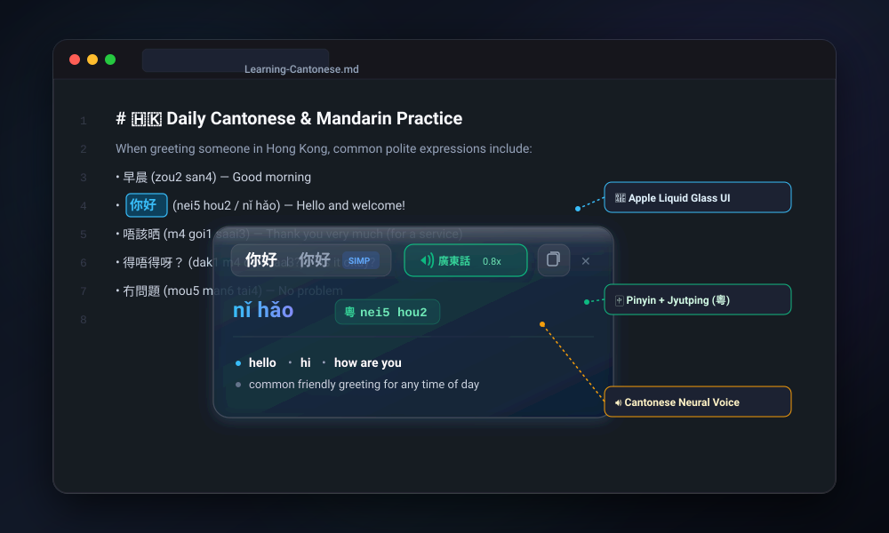

# 🏮 Chinese Popover Dictionary for Obsidian

<p align="center">
  
</p>

<p align="center">
  <a href="https://obsidian.md"></a>
  <a href="https://github.com/Kantulaev/obsidian-chinese-popover/releases"></a>
  <a href="LICENSE"></a>
  
  
  
  
</p>

<p align="center">
  <b>Instant, beautiful Chinese popover lookup and personal vocabulary book for Obsidian.</b><br/>
  Featuring dual <b>Mandarin Pinyin</b> and <b>Cantonese Jyutping</b>, smart Chinese word selection (word splitting), authentic neural audio pronunciation, simplified & traditional Hanzi, and an Apple Liquid Glass aesthetic.
</p>

---

## 🌟 Why Chinese Popover Dictionary?

Reading and studying Chinese in Obsidian shouldn't pull you out of your flow. **Chinese Popover Dictionary** brings a desktop-grade popover experience directly into your notes:

* 💎 **Apple Liquid Glass Design** — Translucent frosted glass squircle with fluid blur effects, crisp typography, and adaptive light/dark theming.
* ✂️ **Smart Chinese Word Selection (Word Splitting)** — Solves Obsidian's lack of Chinese word boundaries. Double-clicking any Chinese character cleanly selects the exact word (`学习` or `香港`) instead of a single character or the entire paragraph, powered by CEDICT and native `Intl.Segmenter`.
* 📖 **Permanent Personal Vocabulary Notebook** — Star difficult words with `⭐` in 1 click; they are saved permanently into a clean Markdown note in your vault (`Chinese Vocabulary.md`).
* 🃏 **Interactive Sidebar & Flashcards** — Review saved words in a sleek right sidebar tab with search, filters, audio buttons, and tap-to-reveal quiz mode.
* 🀄 **Dual Phonetics (Pinyin + Jyutping)** — Perfect for learners of both Mandarin (`Putonghua`) and Cantonese (`Guangdonghua`).
* 🔊 **Native Voice Pronunciation** — Studio-quality neural audio for both dialects with adjustable playback speed (0.5x – 1.4x) and offline Web Speech support.
* ⚡ **Instant Multi-Trigger Access** — Double-click, hover with modifier key (`Option / Alt / Shift / Cmd / Ctrl`), or hotkey navigation.
* 📚 **Massive Vocabulary (118,000+ words)** — Powered by CC-CEDICT merged with Pleco's Cantonese readings, CC-Canto, and Rime Cantonese.
* 🛡️ **Obsidian Margin Protection** — Automatically stays within your text container and never spills off-screen or into empty side margins.

---

## 📸 Overview

```text
┌────────────────────────────────────────────────────────────────┐
│  你好  |  你好  [SIMP]   🔊 廣東話 0.8x   📋 Copy   ⭐ Star   ✕  │
├────────────────────────────────────────────────────────────────┤
│  nǐ hǎo         粵 nei5 hou2                                   │
├────────────────────────────────────────────────────────────────┤
│  • hello  • hi  • how are you                                  │
│  • common friendly greeting for any occasion                   │
└────────────────────────────────────────────────────────────────┘
```

---

## ✨ Feature Highlights

### 1. Dual Phonetic Support
Display tone-marked Pinyin alongside Cantonese Jyutping simultaneously, or switch modes on the fly:
* **Both (`both`)**: Displays Mandarin Pinyin with diacritics (`nǐ hǎo`) and a dedicated green Jyutping badge (`粵 nei5 hou2`).
* **Pinyin only (`pinyin`)**: Focused view for Mandarin learners.
* **Jyutping only (`jyutping`)**: Tailored for Cantonese learners.
* **Auto by Dialect (`dialect_auto`)**: Automatically highlights the phonetics corresponding to your selected speech dialect.

### 2. Authentic Neural Pronunciation
* **Cantonese (`廣東話`)**: Natural Hong Kong neural voice (`zh-HK` / `yue`).
* **Mandarin (`普通话`)**: Clear Putonghua neural voice (`zh-CN`).
* **Adjustable Speed**: Slow down pronunciation (default `0.8x`) to hear tones with razor-sharp clarity.
* **Smart Fallback**: Online Google HD TTS with automatic fallback to local Web Speech API.

### 3. Simplified & Traditional Hanzi
* Displays both Simplified and Traditional characters side-by-side in equal font size.
* Configurable separator (` - `, ` / `, ` · `, or `( )`).
* Option to hide Traditional characters for a more compact card.

### 4. Smart Positioning & Margin Clamping
* Designed specifically for Obsidian's **"Readable line length"** mode.
* Clamps popovers inside the active note container to avoid hanging awkwardly into empty grey side margins.
* Auto-flips vertically if a word is near the top edge of your screen.

### 5. 📖 Personal Vocabulary Notebook & Flashcards
* **Permanent Vault Storage**: Star difficult words with `⭐` in the popover or via hotkey. All saved words are stored permanently in a clean Markdown note in your vault (`Chinese Vocabulary.md`).
* **Right Sidebar Tab**: Access your vocabulary anytime with the ribbon icon (`book-marked`) or command palette.
* **Interactive Liquid Glass Cards**: Each card shows Simplified/Traditional Hanzi, tone-marked Pinyin, green Jyutping badge, definitions, context sentence, and an instant audio playback button.
* **🃏 Flashcards / Practice Mode**: Click to mask definitions and test your memory before sleep or study sessions. Tap any card to reveal.
* **Context Retention**: Automatically remembers the sentence where you found the word!
* **Full-text Search & Sort**: Filter words instantly by Hanzi, Pinyin, Jyutping, or English meanings. Sort by date or alphabetical order.

### 6. ✂️ Smart Chinese Word Selection (Word Splitting)
Chinese text contains no spaces between words. By default, Obsidian's editor often highlights an entire sentence or just a single character when double-clicked:
* **Native Word Boundaries**: Automatically calculates Chinese word boundaries using CC-CEDICT combined with JavaScript's native `Intl.Segmenter` and dedicated Cantonese grammar heuristics.
* **🇭🇰 First-Class Cantonese Intelligence**:
  * **HKSCS & Astral Plane Support**: Handles Hong Kong Supplementary Character Set characters and CJK extensions (e.g. `𨋢` / lift, `𠵱家` / now, `𨳊`).
  * **Grammar Patterns**: Recognizes colloquial Cantonese A-not-A questions (`去唔去`, `識唔識`, `知唔知`, `食唔食`), potential complements (`睇唔明`, `搞得掂`, `食得落`), and verb aspect particles (`食緊`, `買咗`, `食晒`, `睇吓`).
* **Zero External Dependencies**: 0 KB external WASM bloat — runs entirely via native browser APIs and built-in lexicon without heavy binary downloads or IndexedDB cache.
* **Precise Double-Click Selection**: Snaps editor selection to the exact Chinese word in both Live Preview (editing mode) and Reading View via CodeMirror 6's native `mouseSelectionStyle`.

---

## 🚀 Quick Start

### Installation via Community Directory (Recommended)
1. In Obsidian, go to **Settings** > **Community plugins**.
2. Make sure **Restricted mode** is turned **off**.
3. Click **Browse** and search for `Chinese Popover Dictionary`.
4. Click **Install**, then click **Enable**.

### Manual Installation
1. Download `main.js`, `manifest.json`, and `styles.css` from the latest [GitHub Release](https://github.com/Kantulaev/obsidian-chinese-popover/releases).
2. Create a folder named `chinese-popover-dict` in your vault's plugins folder:
   ```text
   <YourVault>/.obsidian/plugins/chinese-popover-dict/
   ```
3. Place `main.js`, `manifest.json`, and `styles.css` into that folder.
4. Reload Obsidian and enable the plugin under **Settings** > **Community plugins**.

---

## ⌨️ Hotkeys & Commands

All actions can be bound to your favorite keyboard shortcuts under **Settings** > **Hotkeys**:

| Command | Suggested Shortcut | Description |
| :--- | :---: | :--- |
| **Look up word under cursor or selection** | <kbd>Alt</kbd> + <kbd>D</kbd> | Opens popover for active cursor position or selection |
| **Star or unstar word** | <kbd>Alt</kbd> + <kbd>B</kbd> | Adds or removes word from Personal Vocabulary notebook |
| **Open vocabulary in sidebar** | — | Opens the vocabulary notebook panel in the right sidebar |
| **Pronounce active word** | <kbd>Alt</kbd> + <kbd>P</kbd> | Plays audio for current word in chosen dialect |
| **Copy active word card** | <kbd>Alt</kbd> + <kbd>C</kbd> | Copies formatted dictionary entry to clipboard |
| **Switch Dialect** | <kbd>Alt</kbd> + <kbd>S</kbd> | Toggles between Cantonese (`廣東話`) and Mandarin (`普通话`) |
| **Cycle Phonetic Display** | <kbd>Alt</kbd> + <kbd>T</kbd> | Cycles: Both → Pinyin → Jyutping → Auto |
| **Toggle Chinese Dictionary** | — | Enables or disables popover triggers |
| **Close Popover** | <kbd>Escape</kbd> | Closes any open popover immediately |

---

## ⚙️ Customization

Customize everything to match your vault's theme:

* **Personal Vocabulary**:
  * Customizable markdown file path (`Chinese Vocabulary.md`).
  * Auto-save context sentences: On / Off.
  * Practice / flashcard mode toggle.
* **Trigger Modes**: Double-click, Hover with modifier key (<kbd>Alt/Option</kbd>, <kbd>Shift</kbd>, <kbd>Ctrl</kbd>, <kbd>Cmd</kbd>), Hover always, or Hotkeys only.
* **Themes**:
  * 🌌 **Liquid Glass Dark** — Deep glassmorphism with vivid cyan/emerald highlights.
  * ☀️ **Liquid Glass Light** — Frosted translucent glass tuned for light themes.
  * ⬛ **Solid Minimalist** — Opaque card styling with zero transparency.
  * 🔄 **Auto** — Adapts seamlessly to your current Obsidian theme.
* **Card Dimensions**: Adjust popover width (260–460 px), height (130–250 px), and backdrop blur (0–60 px).
* **Typography**: Fine-tune font sizes for Hanzi, Pinyin, and translations independently.

---

## 🔒 Privacy & Security

We believe your notes and thoughts belong solely to you:

* 🛡️ **100% Local Dictionary Queries**: Words are looked up entirely inside your local vault. No note content, text selections, or keystrokes are ever sent to an external server.
* 📁 **Your Data Stays Yours**: Your personal vocabulary is written to standard Markdown in your vault. It will never be locked into proprietary formats and will remain readable forever.
* 🚫 **Zero Telemetry**: No trackers, no cookies, no analytics.
* 🌐 **External Connections**:
  1. **Google TTS API** (`translate.google.com`): When the audio button is clicked, an audio stream is fetched for the selected word. You can switch to **Web Speech API** in settings for 100% offline pronunciation.
  2. **CEDICT Database Download**: On first run, the plugin downloads the offline dictionary database (`cedict.json`, ~42 MB) from GitHub Releases and caches it in your plugin folder for lifetime offline use.

---

## 📜 Credits & Licenses

* **[CC-CEDICT](https://www.mdbg.net/chinese/dictionary?page=cedict)**: Licensed under [Creative Commons Attribution-Share Alike 3.0](https://creativecommons.org/licenses/by-sa/3.0/).
* **[Pleco Software](https://www.pleco.com/)**: Hand-curated Cantonese readings database.
* **[CC-Canto](https://cantonese.org/)**: Additional colloquial Cantonese vocabulary.
* **[Rime Cantonese](https://github.com/rime/rime-cantonese)**: Frequency and phonetic mappings.

---

## 📄 License

Distributed under the [MIT License](LICENSE). Built with ❤️ for the Chinese learning community.
