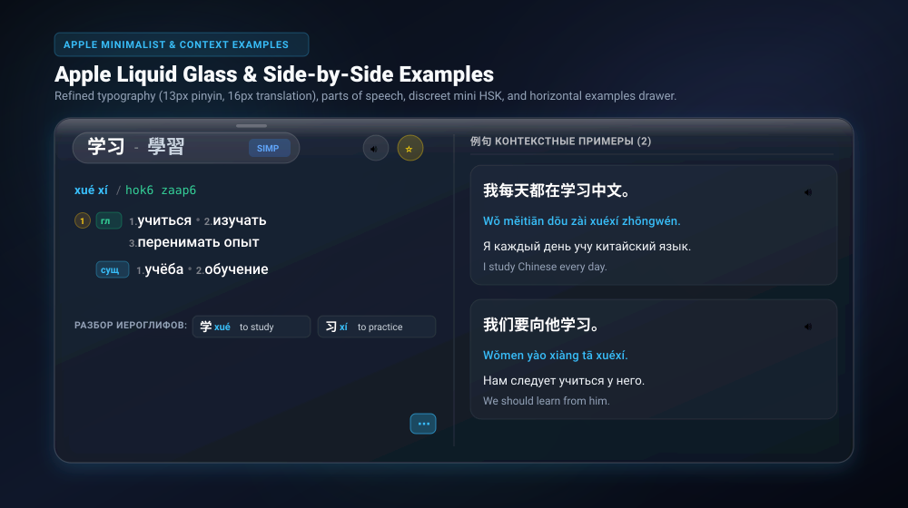
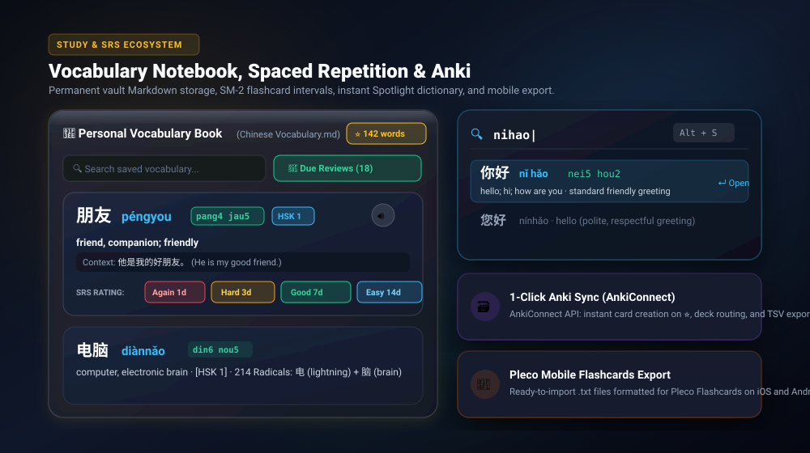
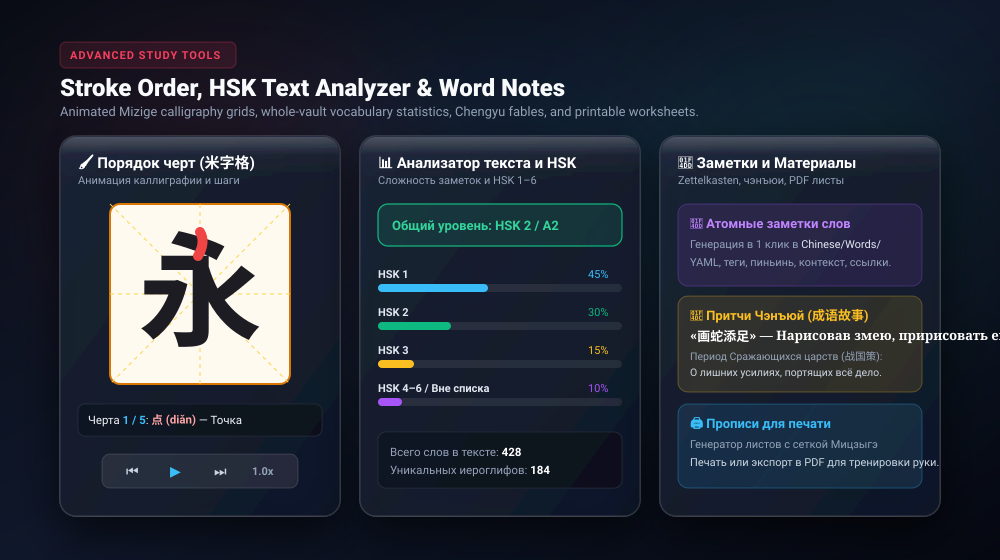

# 🏮 Chinese Popover Dictionary for Obsidian

<p align="center">
  
</p>

<p align="center">
  <a href="https://obsidian.md"></a>
  <a href="https://github.com/Kantulaev/obsidian-chinese-popover/releases"></a>
  <a href="https://www.youtube.com/@ChineseWithKantulaev"></a>
  <a href="https://www.youtube.com/@kantulaevCN"></a>
  <a href="LICENSE"></a>
  
  
  
  
  
</p>

<p align="center">
  <b>Instant, minimalist Chinese popover dictionary and study suite for Obsidian.</b><br/>
  Designed with an <b>Apple Liquid Glass</b> aesthetic, dual <b>Mandarin Pinyin</b> &amp; <b>Cantonese Jyutping</b>, <b>214 Kangxi radicals anatomy</b>, sub-millisecond <b>20-language reverse lookup</b>, and a built-in <b>Spaced Repetition (SRS)</b> vocabulary notebook.
</p>

---

## 💎 Minimalist Apple Liquid Glass Popover

<p align="center">
  
</p>

* **Apple Liquid Glass Aesthetic** — Compact 18px squircle frosted card with fluid backdrop blur, specular borders, and draggable grabber.
* **Balanced Typography** — Crisp Hanzi (`21px`), compact Pinyin (`13px`) with tone coloring, and clear grouped translations (`16px`).
* **Structured Parts of Speech** — Definitions organized by grammar role (verb, noun, adjective, idiom) with discreet mini HSK level indicator (`1`–`6`).
* **Dual Mandarin & Cantonese Audio** — Side-by-side Pinyin and Jyutping with authentic neural audio pronunciation (🔊) for both dialects.
* **214 Kangxi Radicals & Character Anatomy** — Click any character chip to inspect its Kangxi radical, stroke count, meaning, and etymological components (`宀 + 子`).
* **Bidirectional Reverse Lookup (20 Languages)** — Click or select words in English, Russian, Spanish, French, German, Japanese, Korean, and 13 other languages to instantly reveal Chinese translations and Pinyin.

---

## 📚 Study Ecosystem & Spaced Repetition (SRS)

<p align="center">
  
</p>

* **Permanent Vault Vocabulary Notebook** — Star any word (`⭐`) to save it directly into `Chinese Vocabulary.md` with automatically captured context sentences.
* **Spaced Repetition Flashcards (SRS)** — Built-in SM-2 review intervals (**Again 1d**, **Hard 3d**, **Good 7d**, **Easy 14d**) with a dedicated Due Reviews filter right inside your vault sidebar.
* **Spotlight Quick Search (`Alt + S`)** — Instant sub-millisecond modal to search 118,000+ entries across Hanzi (`你好`), Pinyin (`nihao`), Jyutping, or foreign translations.
* **1-Click Anki Sync & Pleco Export** — Auto-sync star additions to desktop Anki via AnkiConnect or export ready-to-import `.txt` decks for Pleco mobile on iOS and Android.

---

## 🖌️ Calligraphy & Advanced Chinese Tools

<p align="center">
  
</p>

* **Animated Stroke Order (米字格 Mizige)** — Step-by-step vector calligraphy animation modal with character navigation tabs and playback speed controls.
* **Text Difficulty & HSK Analyzer (`Alt + A`)** — Evaluates entire notes or selections, displaying HSK 1–6 percentage distribution and CEFR difficulty ratings.
* **Printable Calligraphy Worksheets** — Generate custom Mizige / Tianzige practice sheets with stroke tracing and blank practice grids for PDF export or printing.
* **Ancient Chengyu Stories (成语故事)** — Expandable ancient fables, literal and figurative meanings, and historical dynasty context for 4-character idioms.

---

## 🚀 Quick Start

### Community Plugins Directory (Recommended)
1. In Obsidian, open **Settings** → **Community plugins**.
2. Turn **Restricted mode** off.
3. Click **Browse**, search for `Chinese Popover Dictionary`.
4. Click **Install**, then click **Enable**.

### Manual Installation
1. Download `main.js`, `manifest.json`, and `styles.css` from the latest [GitHub Release](https://github.com/Kantulaev/obsidian-chinese-popover/releases).
2. Place them into your vault folder:
   ```text
   <YourVault>/.obsidian/plugins/chinese-popover-dict/
   ```
3. Reload Obsidian and enable the plugin under **Settings** → **Community plugins**.

---

## ⌨️ Essential Hotkeys

All actions can be customized under **Settings** → **Hotkeys**:

| Command | Shortcut | Description |
| :--- | :---: | :--- |
| **Look up word under cursor or selection** | <kbd>Alt</kbd> + <kbd>D</kbd> | Opens popover dictionary for active cursor or selected phrase |
| **Star word to Vocabulary Notebook** | <kbd>Alt</kbd> + <kbd>B</kbd> | Adds or removes word from your `Chinese Vocabulary.md` note |
| **Spotlight Quick Search** | <kbd>Alt</kbd> + <kbd>S</kbd> | Instant search modal across 118,000+ words and 20 languages |
| **Analyze Text Difficulty & HSK** | <kbd>Alt</kbd> + <kbd>A</kbd> | Computes HSK 1–6 level distribution and CEFR difficulty |
| **Pronounce active word** | <kbd>Alt</kbd> + <kbd>P</kbd> | Plays neural audio pronunciation in active dialect |
| **Close Popover** | <kbd>Escape</kbd> | Closes any open popover immediately |

---

## 🔒 Privacy & Security

* 🛡️ **100% Local Vault Queries** — Words are looked up entirely inside your local vault. No note content, text selections, or keystrokes are ever sent to remote servers.
* 📁 **Your Data Stays Yours** — Your personal vocabulary is written to standard Markdown in your vault.
* 🚫 **Zero Telemetry** — No analytics, tracking, or cookies.
* 🌐 **External Connections** — Google TTS API (optional, can be switched to 100% offline Web Speech API in settings) and initial offline dictionary download from GitHub Releases.

---

## 📺 Free Video Courses by Author

Learn Chinese for free with structured video courses created by the author:

| Channel | Language | Description | Link |
| :--- | :---: | :--- | :---: |
| **Chinese with Kantulaev** | 🇬🇧 English | Comprehensive Chinese courses from beginner to fluent: tones, stroke order, grammar, and conversation. | [**@ChineseWithKantulaev**](https://www.youtube.com/@ChineseWithKantulaev) |
| **Курсы китайского языка** | 🇷🇺 Русский | Пошаговые видеоуроки китайского языка: фонетика, ключи Канси, разбор уровней HSK и живая разговорная речь. | [**@kantulaevCN**](https://www.youtube.com/@kantulaevCN) |

---

## 📜 Credits & License

* **[CC-CEDICT](https://www.mdbg.net/chinese/dictionary?page=cedict)** — Licensed under [CC BY-SA 3.0](https://creativecommons.org/licenses/by-sa/3.0/).
* **[Pleco Software](https://www.pleco.com/)** — Hand-curated Cantonese readings database.
* **[CC-Canto](https://cantonese.org/)** — Additional colloquial Cantonese vocabulary.
* **[Rime Cantonese](https://github.com/rime/rime-cantonese)** — Frequency and phonetic mappings.

Distributed under the [MIT License](LICENSE). Built with ❤️ for the Chinese learning community.
